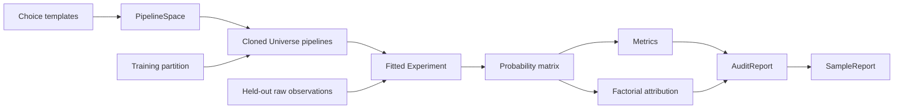

# Architecture Overview

The modules follow the data ownership boundaries. choice.py stores unfitted estimator snapshots. universe.py constructs independent pipelines. space.py validates ordered stages and generates coordinates. experiment.py owns fitted state and creates audit snapshots. metrics.py and attribution.py are numerical functions independent of training. report.py stores structured results and renders them with Rich. demo.py and cli.py are thin user-facing entry points.

There is no scoring or optimization layer. Sample ranking selects observations for inspection, never pipelines for deployment. This architectural distinction is central to [[Vision]].

All computation is serial in memory. Input copies deliberately favor isolation over throughput. An experiment keeps its latest audit for convenience; returned reports preserve earlier observations and thresholds. The library exposes fitted universes for inspection, with mutation documented as invalidating results.

See [[Choice and Pipeline Space]], [[Universe Model]], and [[Experiment Lifecycle]]. Potential caching and graph boundaries are research proposals in [[Long-Term Architecture]], not hidden 0.1 capabilities.
